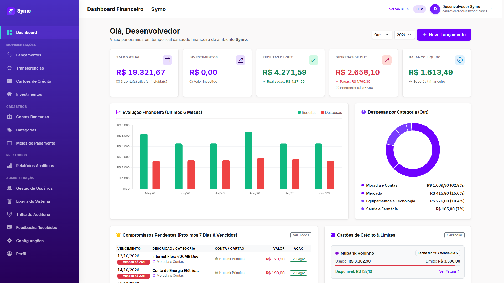
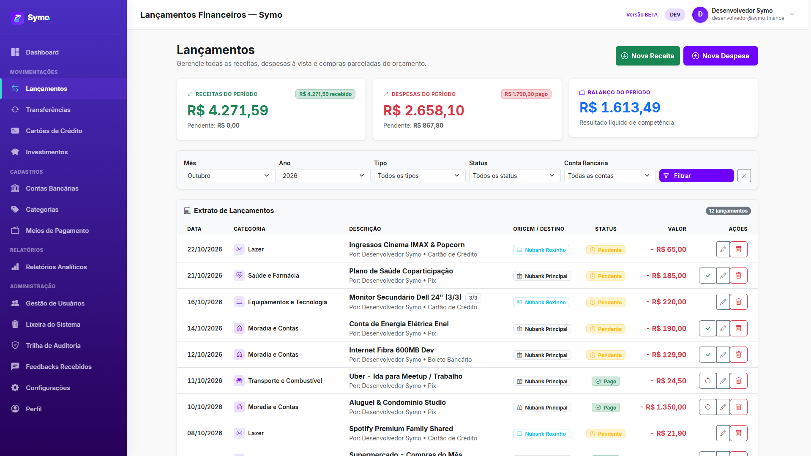
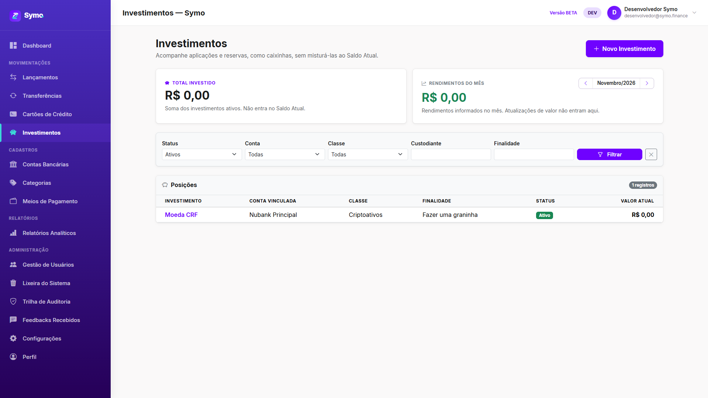
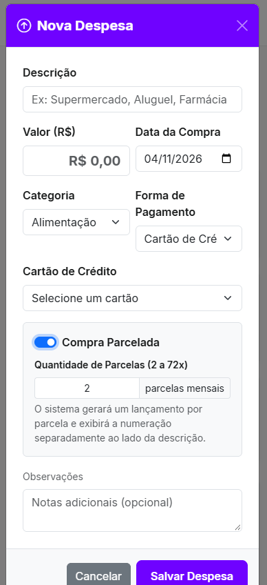
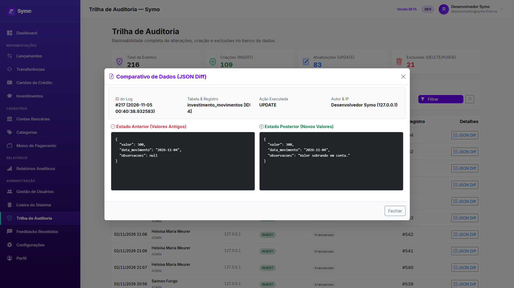
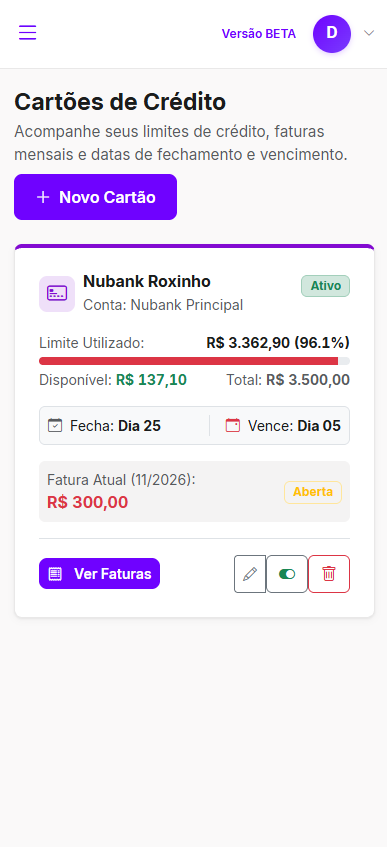

# Symo Finance


O **Symo Finance** é uma plataforma web de gestão financeira pessoal e empresarial leve para pessoas físicas, casais, famílias, freelancers e MEIs. Cada usuário possui uma conta financeira privada por padrão e, na visão de evolução do produto, poderá compartilhar seletivamente contas específicas com outros participantes.

O projeto foi construído em **PHP 8.2+ nativo com arquitetura MVC própria** (`declare(strict_types=1)`), sem frameworks pesados, utilizando **PostgreSQL no Neon** como banco principal, **Vercel** para execução serverless, **Vercel Blob** para armazenamento privado de mídias e **GitHub Actions** para orquestração remota de migrações. O MySQL permanece apenas como caminho de compatibilidade legada.

---

## Demonstração Visual da Plataforma

<div align="center">
  
  <p><em>Dashboard financeiro em tempo real: KPIs consolidados, gráficos interativos locais com Chart.js, compromissos pendentes e cartões de crédito.</em></p>
</div>

### Experiência Desktop & Mobile (Totalmente Responsiva)

O Symo Finance foi concebido com design fluído para funcionar perfeitamente em telas ultrawide, notebooks, tablets e smartphones:

| Desktop (Alta Densidade de Informação) | Mobile (Uso na Palma da Mão) |
| :--- | :--- |
| <br><em>Listagem financeira com filtros avançados e tabela zebrada</em> | <br><em>Dashboard mobile com menu offcanvas em gradiente</em> |
| <br><em>Investimentos e reservas patrimoniais separados do saldo operacional</em> | <br><em>Lançamento de despesas no cartão com parcelamento</em> |
| <br><em>Trilha de auditoria completa com comparativo visual Antes vs. Depois</em> | <br><em>Acompanhamento de limites de cartões e faturas</em> |

<div align="center">
  <a href="docs/screenshots/README.md">
    
  </a>
  <a href="docs/code.html">
    
  </a>
</div>

> [!NOTE]
> **Projeto em Construção e Evolução Contínua (Versão Beta):**<br>
> O **Symo Finance** possui um núcleo financeiro operacional (contas, cartões, despesas, transferências e investimentos), mas segue em desenvolvimento ativo. Tanto na interface (detalhes visuais e espaçamentos a lapidar) quanto no backend (regras de negócio e fluxos a aprimorar), o sistema passa por testes e melhorias frequentes. Justamente por isso, a aplicação conta com um canal nativo de **Feedback com envio de imagens** — acessível ao clicar no botão **"Versão BETA"** na barra superior —, permitindo que inconsistências sejam identificadas e refinadas a cada ciclo de evolução.

---

## Destaques de Engenharia e Segurança

- **MVC Nativo Desacoplado (`strict_types=1`):** Front Controller único ([`index.php`](index.php)), roteador HTTP dedicado ([`Router.php`](app/Helpers/Router.php)) com conversão segura de parâmetros, camada de persistência PDO e separação estrita de responsabilidades sem dependência de bibliotecas externas de terceiros no backend.
- **Adaptação Transparente para Neon PgBouncer:** A classe [`SymoPostgresConnection`](config/database.php) gerencia conexões PostgreSQL com SSL obrigatório, compatibiliza *prepared statements* para o pooler do Neon em modo transação e normaliza funções SQL entre PostgreSQL e MySQL legado.
- **Integridade Financeira e Concorrência Atômica:** Operações que movimentam saldos bancários (lançamentos pagos, transferências internas, estornos da lixeira, quitação de faturas e aportes/resgates de investimentos) rodam dentro de transações PDO atômicas com validação condicional diretamente no `UPDATE`, impedindo saldos negativos por cliques ou requisições concorrentes.
- **Motor de Ciclos de Cartão e Calendário Bancário Nacional:** O helper [`CreditCardCalendar.php`](app/Helpers/CreditCardCalendar.php) aplica fronteira exclusiva de fechamento, preserva o dia mensal em compras parceladas (com ajuste de resíduo de centavos na 1ª parcela e tratamento de meses curtos como fevereiro) e transfere vencimentos que caem em fins de semana ou feriados bancários nacionais para o próximo dia útil.
- **Segurança em Camadas (Defense in Depth):**
  - **Isolamento Anti-IDOR:** Todas as consultas e mutações financeiras validam o `usuario_id` autenticado no backend.
  - **RBAC Segmentado:** Usuários comuns operam como `admin` exclusivamente sobre sua própria conta; o perfil técnico `dev` administra a operação global da plataforma sem acesso a dados financeiros de terceiros.
  - **Proteções Web:** Prepared Statements em 100% das queries, escape XSS contextual (`htmlspecialchars`), tokens anti-CSRF em todas as rotas mutáveis (`POST`), sessões persistidas em banco com cookies `HttpOnly`, `SameSite=Lax` e `Secure`, e bloqueio temporário contra força bruta registrado em `seguranca_logs`.
  - **Mídias Privadas e Anti-CSV Injection:** Uploads passam por validação de MIME real (`finfo_file`) e proxy privado ([`api/blob.js`](api/blob.js)) autenticado via `crypto.timingSafeEqual`, nunca ficando expostos em URLs públicas. A exportação CSV neutraliza caracteres iniciais de fórmulas (`=`, `+`, `-`, `@`).

---

## Funcionalidades Atuais

- **Autenticação e Autocadastro:** Criação de conta com clonagem automática de categorias e preferências iniciais, login com proteção contra força bruta e sessões persistidas no banco.
- **Dashboard em Tempo Real:** Cards de Saldo Atual (contas operacionais selecionadas), Total Investido (separado do saldo operacional), Receitas, Despesas e Balanço Líquido, gráficos interativos locais (Chart.js), compromissos pendentes dos próximos 7 dias e resumo de limites de cartões.
- **Movimentações Completas:** Receitas, despesas à vista ou parceladas em $N$ vezes, transferências atômicas entre contas, cartões de crédito com fechamento e liquidação integral de faturas, e módulo de **Investimentos** (posições, aportes, resgates, rendimentos e atualização patrimonial).
- **Cadastros e Personalização:** Contas bancárias (com controle individual de inclusão no Saldo Atual), categorias com ícones e cores, catálogo global de meios de pagamento com ativação individual por usuário, e gestão de perfil com avatar privado.
- **Relatórios e Auditoria:** Relatórios analíticos e sintéticos por categoria com exportação CSV (UTF-8 com BOM para abertura direta no Excel), Lixeira com restauração atômica de saldos, Trilha de Auditoria com comparativo visual **JSON Diff** (antes vs. depois) e painel de disparo/logs de migrações via GitHub Actions.

## O que ainda está no Roadmap

- **Login com Google OAuth 2.0** (estrutura de banco e configurações já preparadas).
- **Verificação de e-mail e recuperação de senha por e-mail** (a tela de esqueci a senha existe, mas o disparo/redefinição ainda não está integrado).
- **Contas compartilhadas por convite (Fase 18):** compartilhamento seletivo por vínculo de permissão à conta, onde o convidado visualiza apenas lançamentos posteriores ao aceite.

Esses itens representam a direção futura de produto e não estão ativos no estado atual do código.

---

## Arquitetura

```text
Navegador
  -> Vercel / api/index.php
  -> Front Controller PHP (index.php) / MVC
  -> Neon PostgreSQL (SSL)
  -> Vercel Blob privado via api/blob.js (avatares, logotipo e anexos de feedback)

GitHub Actions (Manual ou disparado pelo painel /configuracoes)
  -> migrate.php
  -> Neon PostgreSQL
```

- [`index.php`](index.php): front controller, registro de rotas, cabeçalhos de segurança HTTP e sessão.
- [`app/`](app/): controllers, models, helpers e views.
- [`database/migrations/`](database/migrations/): evolução versionada do schema (migrations 001 a 020+).
- [`api/index.php`](api/index.php): adaptador para o runtime PHP da Vercel e entrega segura de assets públicos.
- [`api/blob.js`](api/blob.js): proxy privado em Node.js para operações autenticadas no Vercel Blob.
- [`.github/workflows/database-migrations.yml`](.github/workflows/database-migrations.yml): workflow de status, migrations, seeds e reset controlado.

---

## Ambientes Oficiais

| Finalidade | Serviços |
| --- | --- |
| Produção e homologação | Vercel + Neon PostgreSQL + Vercel Blob + GitHub Actions |
| Compatibilidade legada | PHP com PDO MySQL/MariaDB |

Para o fluxo oficial, utilize **PHP 8.2 ou superior** com `pdo_pgsql`. O código mantém suporte condicional ao MySQL para instalações legadas, mas novas configurações devem usar `DATABASE_URL` PostgreSQL.

---

## Configuração

A fonte única de leitura de variáveis de ambiente é [`config/config.php`](config/config.php) (com referência documentada em [`config/config.example.php`](config/config.example.php)). O projeto **não armazena segredos no repositório**.

| Variável | Finalidade |
| --- | --- |
| `DATABASE_URL` | URL PostgreSQL do Neon; ativa o driver oficial com SSL. |
| `APP_BASE_URL` | URL pública da aplicação. |
| `APP_ENV` e `APP_DEBUG` | Ambiente e diagnóstico. Em produção, use `production` e `false`. |
| `SYSTEM_DEV_NAME`, `SYSTEM_DEV_EMAIL`, `SYSTEM_DEV_PASSWORD` | Usuário técnico da plataforma criado pelo seed; seus dados financeiros permanecem no próprio escopo. |
| `BLOB_PROXY_SECRET` | Segredo compartilhado entre o PHP e a Function `api/blob.js`. |
| `BLOB_PROXY_URL` | URL da Function `api/blob.js`. |
| `BLOB_READ_WRITE_TOKEN` | Credencial privada do Vercel Blob usada pela Function Node. |
| `GITHUB_ACTIONS_TOKEN` | Token para disparo e leitura de logs do workflow de migrations pelo painel `/configuracoes` (`dev`). |
| `GOOGLE_CLIENT_ID`, `GOOGLE_CLIENT_SECRET`, `GOOGLE_REDIRECT_URI` | Reservadas para o OAuth Google (roadmap). |

---

## Banco de Dados e Migrations

Em ambiente com PHP e `pdo_pgsql` habilitado:

```bash
php migrate.php --status
php migrate.php
php migrate.php --seed
php migrate.php --seed-demo
```

Em produção, execute essas operações pelo workflow manual **Symo Database Migrations** no GitHub Actions, configurando os secrets `NEON_DATABASE_URL`, `SYSTEM_DEV_NAME`, `SYSTEM_DEV_EMAIL` e `SYSTEM_DEV_PASSWORD`.

`php migrate.php --fresh --confirmar` apaga todo o schema PostgreSQL conectado antes de recriá-lo. Use somente em ambiente local descartável. No GitHub Actions, a ação `fresh` exige a confirmação textual `RESETAR`.

---

## Desenvolvimento Local

Fluxo recomendado, sem XAMPP e com banco isolado da produção:

1. Crie uma branch de desenvolvimento no Neon (*Branches → Create branch*) e use a connection string dela, nunca a de produção.
2. Copie [`load-env.example.ps1`](load-env.example.ps1) para `load-env.ps1` (ignorado pelo Git) e preencha `DATABASE_URL`.
3. Opcionalmente, preencha `BLOB_PROXY_URL` e `BLOB_PROXY_SECRET` se desejar testar uploads remotos.
4. Execute `.\load-env.ps1 -Run -Migrate` (use `-Seed` na primeira vez, com `SYSTEM_DEV_*` definidos) para aplicar as migrations e subir o servidor em `http://localhost:8000`. `.\load-env.ps1 -Status` apenas consulta o estado das migrations.

Passos manuais equivalentes:

1. Configure um PostgreSQL acessível e exporte `DATABASE_URL`.
2. Garanta que o PHP tenha `pdo_pgsql`, `pdo`, `mbstring`, `fileinfo`, `json`, `session` e `curl` habilitados.
3. Execute `php migrate.php` e `php migrate.php --seed`.
4. Inicie o servidor embutido do PHP:

```bash
php -S localhost:8000 index.php
```

5. Acesse `http://localhost:8000`.

---

## Documentação do Projeto

Toda a documentação técnica e histórica do projeto está versionada em [`docs/`](docs/):

- **[FSD (Especificação Funcional e Técnica)](docs/FSD.md):** Arquitetura detalhada, regras de negócio, modelo de dados e roadmap.
- **[Guia de Manutenção e Evolução](docs/MANUTENCAO.md):** Manual técnico para desenvolvedores (fluxos MVC, banco de dados, segurança e como criar novas telas/regras).
- **[Design System (Symo)](docs/DESIGN.md):** Paleta de cores, tipografia, tokens CSS e diretrizes de componentes.
- **[Status de Implementação](docs/STATUS.md):** Progresso detalhado das 21 fases de desenvolvimento.
- **[Registro de Erros e Soluções](docs/ERROS.md):** Histórico de diagnósticos técnicos e decisões de engenharia aplicadas.
- **[Como Pedir Mudanças](docs/COMO-PEDIR-MUDANCAS.md):** Guia estruturado com templates para solicitação de evoluções assistidas por IA.
- **[Contexto para Agentes (AGENTS.md)](AGENTS.md):** Protocolo técnico e regras de segurança para manutenção assistida por IA.

---

## Licença

Este projeto é distribuído sob a licença **GNU General Public License v3.0 (GPL-3.0)**. Consulte o arquivo [`LICENSE`](LICENSE) para o texto legal completo.

Em resumo: você pode visualizar, estudar, executar e modificar o código, desde que **mantenha os créditos e avisos de autoria originais** e que qualquer distribuição ou trabalho derivado **permaneça com o código-fonte aberto sob a mesma licença GPL-3.0**, sendo vedado fechar o código para distribuição proprietária.
